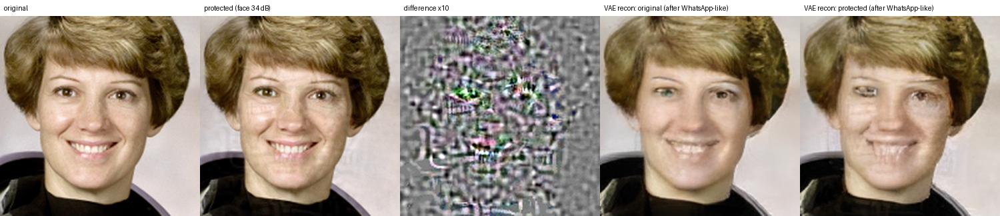

# I3 — Imperceptible Image Immunization with a steganographic payload

A "digital glare for AI eyes": one barely-visible perturbation that

- **disrupts generative editors** (active layer) – a face-focused adversarial perturbation that pushes the
  photo's latent code away from the truth, so VAE-based editors (Stable Diffusion img2img/inpainting,
  morphing pipelines) rebuild a damaged face, and
- **carries a keyed ownership payload** (passive layer) – 64 bits (timestamp + HMAC owner tag,
  Reed-Solomon protected) that survive WhatsApp-style recompression, plus an Ed25519-signed manifest
  for provenance claims.

Both layers are optimised **jointly** through an Expectation-over-Transformation layer that simulates
Indian sharing habits (WhatsApp/Instagram/Telegram resize + JPEG, beauty filters), with a face mask
(W_PIR) and a visibility (JND) map tuned to avoid blotches on smooth / darker skin in low light.


*Sample face (public-domain NASA photo). Left to right: original, protected (face-region PSNR 34 dB),
difference ×10, and what a VAE encoder/decoder makes of each **after** WhatsApp-like compression – the
protected face comes back with smeared eyes and mouth.*

## Results so far (CPU, TAESD surrogate, one sample image – see [docs/EXPERIMENTS.md](docs/EXPERIMENTS.md))

| | value |
|---|---|
| PSNR whole image / face region / SSIM | **41.4 dB / 34.1 dB / 0.977** |
| Payload decoded after | JPEG Q50–90, WebP Q75, WhatsApp-like (×2), Instagram/Telegram-like, resize ½, blur, median, noise, beauty filter |
| Payload **not** decoded after | cropping (no sync template yet) |
| Latent shift on the face after WhatsApp-like | 0.58 (relative) – VAE reconstruction 0.6 dB worse on the face |
| Same, if you only enforce global PSNR 38 dB | 0.88 / 1.8 dB worse – but the face is visibly noisy (face PSNR 27 dB) |

This is a working research prototype, not a finished defence. Read
[docs/THREAT_MODEL.md](docs/THREAT_MODEL.md) before claiming anything.

## Stable Diffusion before / after demo (current milestone)

[](https://colab.research.google.com/github/Yash-Raj11/i3-stego-immunization/blob/main/notebooks/sd_demo_colab.ipynb)  ← runs the whole demo on a free cloud GPU (recommended if your laptop has ≤16 GB RAM)

```bash
pip install -e ".[sd]"
i3 demo assets/sample_astronaut.png --owner you@example.com --config configs/sd_demo.yaml --out reports/demo_sd
```
Protects the photo against the real SD VAE, then runs the **same** Stable Diffusion 1.5 img2img and
inpainting edits (same prompt and seed) on the original and on the immunised photo, and writes
`before_after.png`, `grid.png` and a metrics report. Details and tuning: [docs/DEMO.md](docs/DEMO.md).
In VS Code: *Terminal → Run Task… → "i3: SD demo (sample)"*. In Claude Code: `/i3-sd-demo`.

## Quick start

Full step-by-step instructions (Windows/macOS/Linux, VS Code, Git/GitHub, Claude Code):
**[docs/SETUP_GUIDE.md](docs/SETUP_GUIDE.md)**.

```bash
python -m venv .venv && source .venv/bin/activate     # Windows: .\.venv\Scripts\Activate.ps1
pip install torch --index-url https://download.pytorch.org/whl/cpu
pip install -e ".[dev]"
python scripts/download_models.py
i3 keygen
python -m pytest -m "not slow"

i3 protect photo.jpg --owner you@example.com --debug       # -> photo.protected.png + photo.protected.i3.json
i3 verify  shared_copy.jpg --owner you@example.com --manifest photo.protected.i3.json
i3 evaluate --original photo.jpg --protected photo.protected.png --out reports/photo
i3 inspect-jpeg whatsapp_download.jpg                    # calibrate against the real platform
```

Useful flags for `protect`: `--steps` (20 for quick tests, 300 on GPU), `--face-psnr` (visibility on
the face, default 34), `--psnr` (whole image, default 38), `--mode untargeted|targeted`,
`--surrogate taesd|sd-vae|taesd+sd-vae`, `--payload-alpha` (payload strength), `--device cuda`,
`--generator models/generator.pt` (Phase-2 warm start).

## Repository layout

```
src/i3/            the package (see CLAUDE.md for a file-by-file map)
  immunize.py        joint optimiser        stego.py     spread-spectrum codec
  payload.py         64-bit payload + RS    saliency.py  W_PIR face mask
  transforms.py      EOT layer              diff_jpeg.py differentiable JPEG
  jnd.py             visibility map         attacks.py   real-codec evaluation attacks
  surrogates.py      TAESD / SD-VAE         generator.py Phase-2 "vaccine" generator
configs/default.yaml all tunables
scripts/           download_models.py, train_generator.py
tests/             pytest suite (no downloads needed except the face detector, optional)
docs/              SETUP_GUIDE · ROADMAP (with Claude Code prompts) · ARCHITECTURE · EXPERIMENTS ·
                   THREAT_MODEL · LEGAL_NOTES
.claude/           Claude Code settings + project skills (/i3-eval, /i3-experiment, /i3-next-phase)
.vscode/           interpreter/test/format settings, debug configs, tasks
```

## How it works (one paragraph)
The photo is downscaled, faces are found on an illumination-normalised copy, and two maps are built:
**W_PIR** (eyes, lips, brows, nose, jaw contour weighted highest) and a **JND** visibility map. A payload
is Reed-Solomon coded and embedded in closed form as a spread-spectrum pattern on a resize-invariant
256×256 DCT grid, cancelling the image's own interference. Then ~100 optimisation steps sample random
"social-media pipelines" (resize, filter, blur, noise, differentiable JPEG, crop) and update the
adversarial component with L2-normalised steps to push the surrogate encoder's face latent away from
the original, while a margin loss keeps every payload bit decodable. Hard projections keep PSNR ≥ 38 dB
overall and ≥ 34 dB on the face, with chroma noise limited. Details and the design rationale:
[docs/ARCHITECTURE.md](docs/ARCHITECTURE.md).

## Prior work and what is new here

This project builds on published ideas and cites them; the implementation in this repository is
written from scratch for this project.

| idea taken from prior research | source |
|---|---|
| attacking the image encoder of a latent diffusion model to spoil edits | PhotoGuard (Salman et al., ICML 2023) |
| imperceptible "cloaks" against generative mimicry | Glaze (Shan et al., USENIX Security 2023) |
| optimising through random transformations (EOT) | Athalye et al., ICML 2018 |
| spread-spectrum watermarking, improved spread spectrum | Cox et al. 1997; Malvar & Florêncio 2003 |
| JND / perceptual masking | Chou & Li 1995 |

What this project adds (the original contribution):
1. **Steganographic immunisation** – one perturbation optimised *jointly* for latent disruption and a
   keyed, error-corrected ownership payload, so the protection also carries provenance evidence.
2. **Face-relevancy budget (W_PIR) + JND shaping + a face-region visibility constraint**, instead of a
   uniform L∞ budget over the whole image.
3. **An EOT distribution modelled on Indian sharing habits** (WhatsApp/Instagram/Telegram resizing and
   recompression, beauty filters) and evaluation with real codecs and purification attacks.
4. **Inclusivity by design** – illumination-normalised face analysis and chroma-limited budgets aimed at
   darker skin tones and low-light photos (audit planned).
5. Provenance package for Indian cyber-law complaints (signed manifest; see docs/LEGAL_NOTES.md).

## Roadmap
SD-VAE/img2img validation, identity (ArcFace) surrogate for face-swap, crop-robust payload, generator
training + mobile export, skin-tone/low-light audit – each with a ready-to-paste Claude Code prompt in
[docs/ROADMAP.md](docs/ROADMAP.md).

## Credits & licence
MIT (see LICENSE). TAESD architecture vendored from madebyollin/taesd (MIT). Sample image: NASA
(public domain, via scikit-image). Inspired by PhotoGuard (Madry Lab, MIT) and Glaze (University of Chicago).
