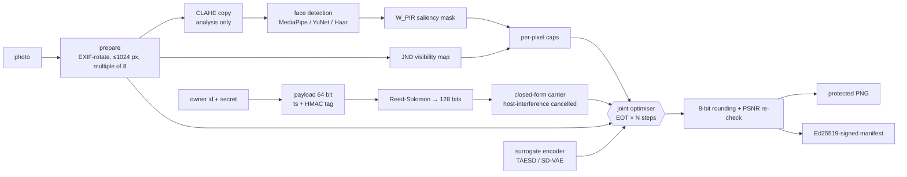

# Architecture & design decisions

## Pipeline



Inside each optimisation step:

```
x_p = clip(x + YCbCr→RGB(δ_adv) + vis · Carrier(A))
for each EOT sample T (resize, beauty filter, blur, noise, differentiable JPEG, crop):
    L_adv = −‖E(T(x_p)) − E(T(x))‖²_W_PIR / ‖E(T(x))‖²      (untargeted, face-weighted)
    L_wm  = mean relu(1 − b·s(T(x_p)) / margin)               (payload margin, no crop)
δ_adv ← δ_adv − lr · momentum(∇/‖∇‖₂)         (L2 step)
A     ← Adam step (small lr)
project: |δ_adv| ≤ caps, ‖carrier‖² ≤ 1.1·initial, PSNR ≥ 38 dB, face PSNR ≥ 34 dB
```

## How the original concept was adapted (and why)

The concept document is a strong starting point. Building it surfaced eight places where the
literal version would not work, and what the prototype does instead:

1. **"Steganography" has to become robust watermarking.** Classic adaptive steganography (S-UNIWARD,
   HUGO, cost maps) hides bits in the finest texture *because* that is where they are least visible –
   which is exactly what WhatsApp's resize + JPEG Q≈70 discards. Using W_PIR to place message bits on
   facial edges makes them *less* robust. The payload here is spread-spectrum in the mid band of a
   canonical, resize-invariant grid, with Reed-Solomon coding.

2. **"The stego message is the adversarial perturbation" is realised as joint optimisation.** A
   64-bit message cannot by itself carry enough energy in the right directions to disrupt an encoder.
   Instead one perturbation has two parameterisations optimised under one loss: the carrier is free to
   reshape itself to also hurt the encoder (within a fixed energy), and the adversarial component is
   penalised for erasing the payload. Both pass through the same EOT layer.

3. **Global PSNR ≥ 38 dB is not "imperceptible" when the noise is concentrated on the face.** With
   saliency masking, 38 dB over the whole image allowed ~27 dB on the face – clearly visible (see
   EXPERIMENTS E4). The prototype adds a face-region PSNR constraint (default 34 dB) and reports both.

4. **Histogram equalisation is for analysis, not for the output.** Equalising the photo before adding
   the "vaccine" would visibly change it. CLAHE is applied only to the copy used for face detection and
   edge maps; the perturbation budget is adapted with a JND map instead (lower on smooth skin, lower
   chroma), which is what avoids blotches on darker or smoother skin.

5. **"Mid-to-high frequency survives filters" is backwards.** Filters and JPEG remove *high*
   frequencies first; what survives is low-to-mid frequency, which is also more visible. EOT finds the
   compromise automatically rather than by hand-picking bands – and the measured best payload band is
   the middle one (EXPERIMENTS E5).

6. **A single universal mask (UAP) is fast but weak and removable.** The same pattern on every photo
   can be estimated by averaging several protected images and subtracted; it also fingerprints the app
   and cannot follow each face's landmarks. Phase 2 uses an image-conditioned generator (UAP-like
   speed, per-image output) plus a few refinement steps.

7. **No claims about closed models.** Midjourney and most commercial face-swap services expose no
   gradients and change models without notice; transfer to them is unknown. The prototype measures
   against open models only (TAESD, SD-VAE; identity encoders in Phase 3) and says so.

8. **Face-swap engines are attacked through identity, not a VAE.** InSwapper/SimSwap-style tools use an
   ArcFace identity embedding plus a face detector. A VAE-encoder attack mainly protects against
   diffusion img2img/inpainting. Roadmap P3.1 adds an identity surrogate.

## Module responsibilities
See the code map in `CLAUDE.md`. Key design choices:

- **Canonical grid (256²)** makes the payload invariant to proportional resizing; cropping and aspect
  changes break sync (roadmap P4.1).
- **Host-interference cancellation** (`init_payload_amplitudes`): each bit's correlation on the clean
  image is set to exactly ±α in closed form – no encoder needed, so it is cheap enough for phones.
- **Keyed everything**: slot permutation and chips derive from SHA-256(secret); the tag is an HMAC.
  Without the key the payload is hard to read or forge, but not hard to *destroy* (see THREAT_MODEL).
- **Replayable EOT** (`draw` / `apply`): the untargeted loss compares protected vs original under the
  *same* random transform, which removes transform noise from the objective.
- **Evaluation uses real codecs** (Pillow libjpeg / libwebp) and *purification* attacks, never the
  differentiable approximations used in training – otherwise results would be optimistic.

## References (starting points for your report)
- Salman et al., *Raising the Cost of Malicious AI-Powered Image Editing* (PhotoGuard), ICML 2023.
- Shan et al., *Glaze: Protecting Artists from Style Mimicry by Text-to-Image Models*, USENIX Security 2023.
- Athalye et al., *Synthesizing Robust Adversarial Examples* (EOT), ICML 2018.
- Madry et al., *Towards Deep Learning Models Resistant to Adversarial Attacks* (PGD), ICLR 2018.
- Moosavi-Dezfooli et al., *Universal Adversarial Perturbations*, CVPR 2017.
- Cox et al., *Secure Spread Spectrum Watermarking for Multimedia*, IEEE TIP 1997.
- Malvar & Florêncio, *Improved Spread Spectrum*, IEEE TSP 2003.
- Shin & Song, *JPEG-resistant Adversarial Images*, NeurIPS MLSec workshop 2017 (differentiable JPEG).
- Holub, Fridrich & Denemark, *Universal distortion function for steganography* (S-UNIWARD), 2014.
- Chou & Li, *A perceptually tuned subband image coder based on JND*, IEEE TCSVT 1995.
- Hönig et al., *Adversarial Perturbations Cannot Reliably Protect Artists From Generative AI*, ICLR 2025.
- Zhao et al., *Invisible Image Watermarks Are Provably Removable Using Generative AI*, 2023.
- Kärkkäinen & Joo, *FairFace* (balanced race/gender/age face dataset incl. an "Indian" group), WACV 2021.
- Monk Skin Tone Scale (Google, 2022) – a 10-point alternative to Fitzpatrick for CV fairness audits.
- TAESD (madebyollin/taesd); YuNet (OpenCV Zoo); MediaPipe Face Landmarker.
